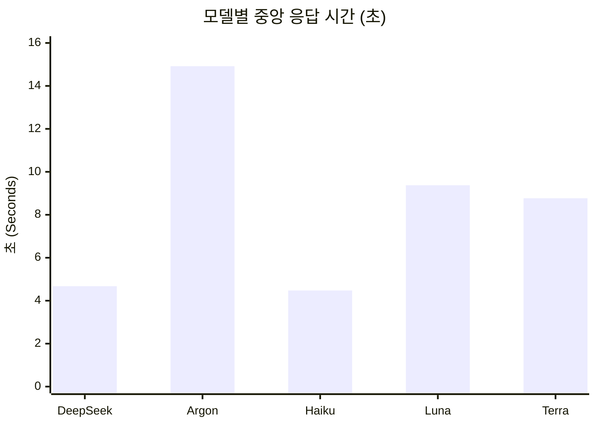

# skim 역할 후보 비교 (2026-10-27)

5개의 소스 파일을 읽고 답하는 정적 코드 질문 과제로 `skim` 역할 후보 모델을 비교했습니다. [측정값과 답변별 판정](./skim-2026-10-27.data.json)을 함께 공개합니다.

## 결과 요약

| 모델 | 명확 일치 | 원형 JSON 배열 준수 | 응답 시간 중앙값 (최소~최대) |
| :--- | :---: | :---: | :---: |
| **DeepSeek V4.1 Flash 1017** (`hive/deepseek-ai/deepseek-v4.1-flash-1017`) | 81 / 90 | 10 / 10 | 4.68초 (3.13~6.45초) |
| **Argon** (`aistudio/gemini-4-argon`) | 90 / 90 | 10 / 10 | 14.92초 (10.51~52.45초) |
| **Haiku 5.5** (`anthropic/claude-haiku-5-5`) | 54 / 90 | 8 / 10 | 4.48초 (1.23~5.65초) |
| **GPT-6 Luna** (`openai-codex/gpt-6-luna`) | 90 / 90 | 10 / 10 | 9.38초 (7.82~11.31초) |
| **GPT-6.1 Terra** (`openai-codex/gpt-6.1-terra`) | 90 / 90 | 10 / 10 | 8.77초 (6.85~10.32초) |

## 세부 판정 및 오류 내역

* **오답 및 불필요한 unknown 분류**
  * **GPT-6.1 Terra, GPT-6 Luna, Argon**은 모순/잘못된 극성 0건, 불필요한 `unknown` 0건으로 90개 판정 모두 명확 일치를 기록했습니다.
  * **DeepSeek V4.1 Flash 1017**은 명확 일치 81건 외에 모순/잘못된 극성 5건, 불필요한 `unknown` 4건이 발생했습니다.
  * **Haiku 5.5**는 명확 일치 54건 외에 모순/잘못된 극성 5건, 불필요한 `unknown` 31건이 발생했습니다.
* **JSON 형식 준수**
  * 원형 JSON 배열(`rawJsonArrays`)만 형식 준수로 인정했습니다.
  * **Haiku 5.5**의 형식 실패 2건은 묶음 B의 round 2(NDJSON 반환)와 round 4(코드펜스로 감싼 JSON 배열 반환)입니다. 의미 평가는 완성된 객체들을 별도로 읽어 수행했으나 형식 준수로는 간주하지 않았습니다.
* **인용 검사**
  * 인용 경로 존재 여부 및 줄 범위 형식 오류는 모든 모델에서 0건이었습니다. 이는 경로와 줄 번호 범위만 확인한 것이며 의미상 인용 정확도를 평가한 별도 점수가 아닙니다.

## 측정 조건 및 절차

5개 소스 파일을 읽는 정적 코드 질문 묶음 2개(A 8문항·B 10문항, 총 고유 질문 18개)를 묶음별 5회 반복했습니다. 모델당 10회 호출하여 총 90회 판정했으며, 이는 90개의 독립 과제가 아닙니다.

실제 `skimQuestion` / `callModel` 경로를 OMP core 18.13.1에서 실행했습니다. 묶음별로 동일한 입력 바이트를 제공했고 라운드마다 후보 호출 순서를 회전했습니다. 후보 외 fallback 호출은 없었습니다.

`maxTokens: 8192`, `disableReasoning: true`를 요청했습니다. 코드에서 `disableReasoning`을 요청하는 것과 제공자가 실제로 추론을 끄는지는 별개이므로, 모든 후보가 동일한 추론 비활성 상태라고 단정할 수 없습니다. 코어 호환 정보 기준 **GPT-6 Luna**와 **GPT-6.1 Terra**는 `low` effort로, **DeepSeek V4.1 Flash 1017**은 `none` effort로 매핑되며, **Argon**의 실제 추론 비활성 여부는 확인되지 않았습니다.

자료 수집 시간을 제외한 `callModel` 경과 시간입니다. 네트워크/API 응답 변동과 캐시 상태가 섞여 있으며 캐시 조건을 통제한 실험은 아닙니다.

호출 전에 판정표를 작성했고 Main이 원문 답변과 소스를 직접 대조했습니다(독립 블라인드 심사 아님). 제공된 소스와 모순이 없는 답변만 '명확 일치'로 집계했습니다. 질문에 `Yes`라고 먼저 답한 뒤 뒤에서 반대되는 설명을 덧붙인 경우는 명확 일치에서 제외했습니다. `unknown` 응답은 의도적으로 정보를 제공하지 않은 `b10` 문항에서만 정답으로 인정하고 나머지 문항에서는 누락으로 처리했습니다.

최초 50호출에서는 `skim.ts`의 credential resolver 소스 한 줄이 보안 필터에 걸려 구현 파일 전체가 입력에서 빠진 것을 Main이 발견하여 최종 품질 표에서 제외했습니다. 보안 필터 자체는 수정하지 않고 비교 사본에서 자격증명 관련 바인딩만 명시적으로 가린 채 줄 번호를 유지했습니다. 이후 모델 호출 전 5개 파일 전체가 누락 없이 포함됨을 확인한 보정 50호출 결과를 본 보고서에 사용했으며 원본 기록을 보정 결과로 덮어쓰지 않았습니다.

## 해석의 한계

* 본 평가는 2개 질문 묶음의 5회 반복 결과이므로 일반 코딩 모델 순위로 확장해 해석할 수 없습니다.
* 네트워크/API 지연 및 캐시 상태가 혼재하고 모델별 내부 추론 매핑이 다르므로 응답 시간 차이의 인과 효과를 주장할 수 없습니다.
* 호출 모델 식별자는 SDK 선택 기준이며 제공자 내부 빌드 fingerprint는 검증하지 않았습니다.

## 결론

* 이 과제에서 답변 일관성은 **GPT-6.1 Terra**, **GPT-6 Luna**, **Argon**이 동급(90/90)입니다.
* 응답이 빠른 **DeepSeek V4.1 Flash 1017**과 **Haiku 5.5**는 모순된 답변과 자료 누락(`unknown`) 답변이 있어 속도만으로 추천할 수 없습니다.
* **GPT-6.1 Terra**(6.85~10.32초)와 **GPT-6 Luna**(7.82~11.31초)는 응답 시간 범위가 겹쳐 특정 모델의 속도 우위를 입증하지 못했습니다.
* 이 과제에서 `skim` 역할 추천 후보는 **GPT-6.1 Terra** 또는 **GPT-6 Luna**입니다. 이번 측정으로 운영 환경의 `skim` 역할 설정을 바꾸지는 않았습니다.

측정 후 사용자가 `skim` 역할로 GPT-6.1 Terra를 선택했습니다. 이 선택은 위 측정 결과와 구분합니다.
